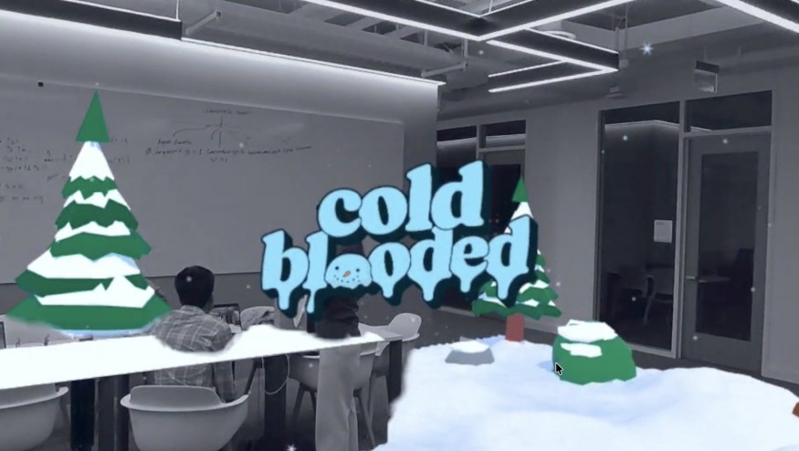
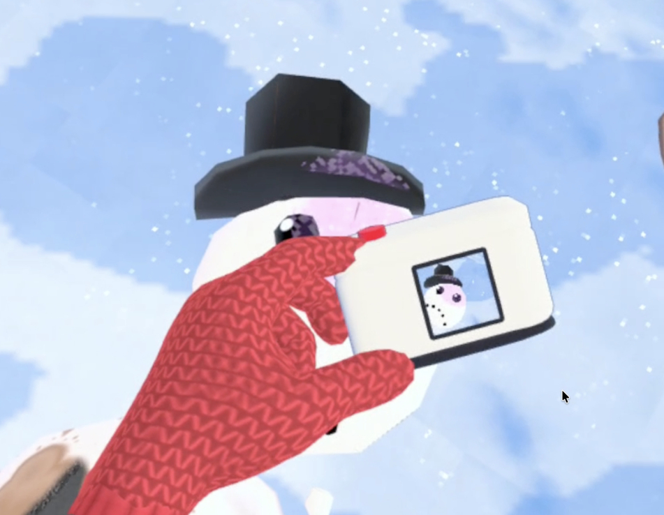
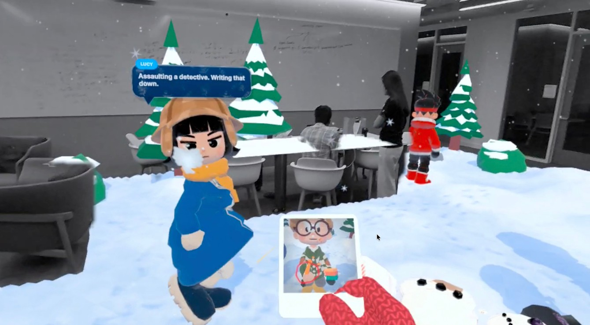
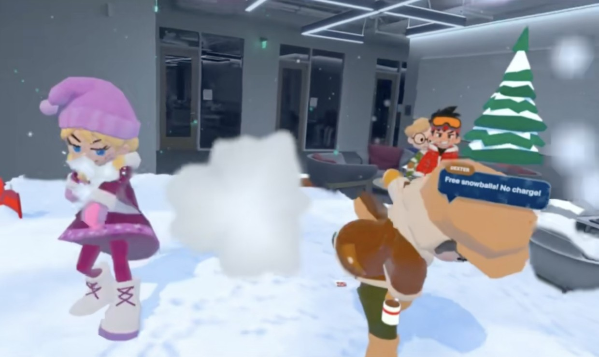
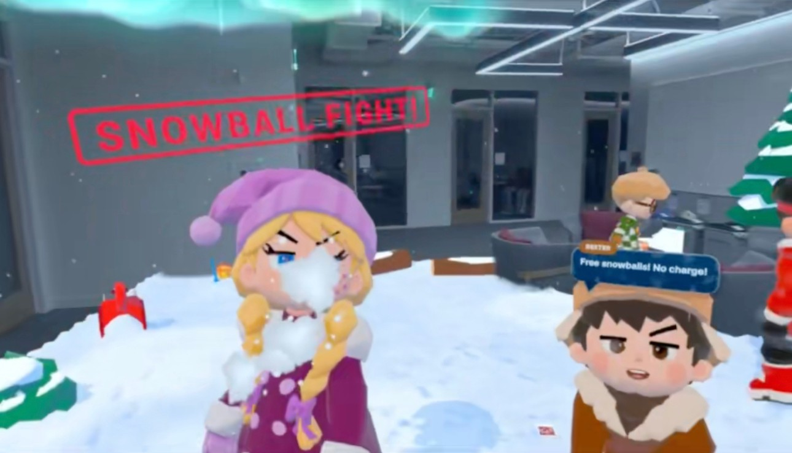
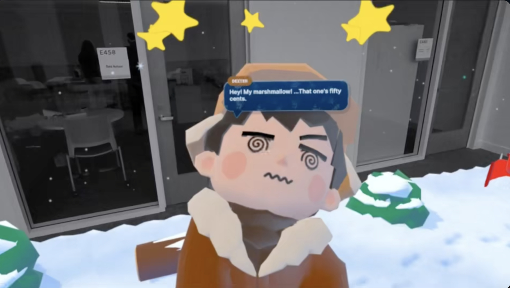
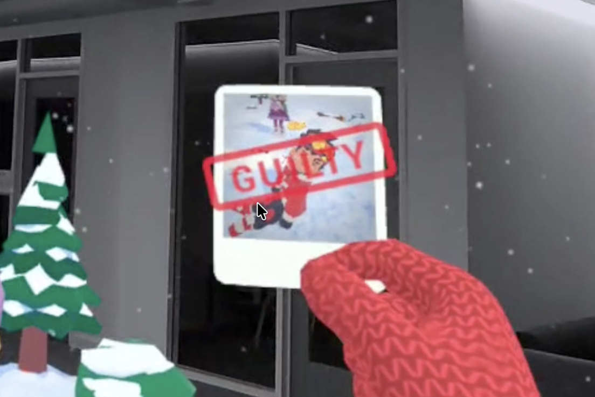

  

  <b>Someone murdered the snowman in your own room.</b> 
  Snap Polaroid clues, grill shady kids, dodge snowballs, and crack the case.

  
  
  
  

**Cold Blooded** is a mixed-reality detective comedy for **Meta Quest 3 / 3S**, that won **3rd place overall** at **Immerse the Bay 2026**. A loud thud behind you reveals Frosty's toppled body, your living room fills with snow and redwoods, and the real world drains to film-noir grey. Pinch to raise a Polaroid, photograph the clues, show each photo to the right kid, and follow their excuses all the way to the culprit. Then catch him on film.

<table>
  <tr>
    <td width="50%"> <b>Pinch to raise the Polaroid.</b> The viewfinder shows exactly what you'll get.</td>
    <td width="50%"> <b>Your real room drains to noir,</b> while the suspects and the clues stay in colour.</td>
  </tr>
  <tr>
    <td> <b>Scoop and throw snowballs</b> (Dexter is very generous with them).</td>
    <td> <b>Hit the same kid three times</b> and it's a snowball fight.</td>
  </tr>
  <tr>
    <td> <b>Every kid reacts to a bonk</b> in their own way.</td>
    <td> <b>Catch the culprit on film</b> to close the case.</td>
  </tr>
</table>

## Inspiration
We wanted a game that uses the spatial freedom of XR for something only XR can do. Detectives observe and explore a physical space for clues, so we gave that a comedic twist: the victim is a snowman, the suspects are five neighbourhood kids, and the crime scene is **your own room**. In mixed reality the suspects walk around your real furniture, hide behind your real sofa and knock on your real door.

Hand tracking shaped the core of the game. There are no menus or laser pointers for the detective work: you pinch a camera into existence, snap the evidence, and hold the photo up to a suspect's face.

## Highlights
- **Your room is the crime scene.** Snow piles up on your floor, trees rise along your walls, and your furniture becomes part of the level that characters can interact with.
- **A pinch-to-shoot Polaroid** with a live viewfinder, and prints you can hold and present to characters.
- **Five fully voiced suspects**, each with their own excuses, poses and reactions to a snowball.
- **A finale chase.** The culprit dodges your lens and ducks behind your furniture.
- **Real-world occlusion** with the Depth API, so the snow and the kids hide behind your actual furniture.

## Meet the suspects
| | |
|---|---|
| **Lucy** | The street's self-appointed detective, and your guide. |
| **Dexter** | Whistling innocently and always carrying a cup of cocoa. |
| **Sherman** | Someone of a nerd, always carrying a stack of books he never puts down. |
| **Serena** | Flips her hair for the camera. Her pom-pom hat flies off when she's snowballed. |
| **Tony "Turbo"** | Owns a red sled with a suspiciously fresh dent. |

Built with Unity 6000.6.9f1 · URP · Meta XR All-in-One SDK v209 (Core, Interaction, MR Utility Kit, Audio, Haptics, Platform) on the OpenXR provider, plus Unity OpenXR Meta 2.7 for the Depth API. Voices by ElevenLabs, character models by Meshy.

---

## Run it

### On a Quest 3 / 3S
1. Run **Space Setup** first (Settings ▸ Physical Space ▸ Space Setup) and mark your walls, **doors** and **furniture**. The game uses all of it. Allow the *spatial data* permission when asked.
2. **File ▸ Build Profiles ▸ Android**, then **Build And Run** with the headset plugged in (developer mode on).
3. Play in a clear space of **at least 3 × 3 m**. The layout is generated fresh every round and scales to your room.

| On the headset | Hand tracking | Controllers |
|---|---|---|
| Start | Poke the **Play** button with a fingertip | Poke it with the controller tip |
| Raise the Polaroid (left hand) | Bring thumb and index together (about 6–9 cm) | Hold **grip** |
| Take a photo | Pinch | **Index trigger** |
| Get the print | It hangs from the slot at the bottom of the camera; the next shot, or putting the camera away, drops it in the snow | Same |
| Show a photo | **Face** the kid and **push** the photo toward them (slowly is fine) | Same |
| Drop the photo in your hand | Open your hand flat | **A / X** |
| Pick a photo up | Reach down to it (it glows softly) and grab | Reach and squeeze **grip** |
| Make a snowball | Free hand open near the snow, then close it | **Grip** near the snow |
| Throw | Swing and open your hand | Swing and release **grip** |
| Pause, or skip the intro | Menu gesture | Menu button (hold it to skip the intro) |

## How it uses your room
- **Your space is the level.** The game reads your walls, doors and furniture from Space Setup. Snowballs splat on your real walls, and a fresh layout is generated every round to fit your room.
- **Real-world occlusion.** A real person or piece of furniture in front of a kid, the snow or a snowball hides it, just as it would in real life.
- **The room tells the story.** Your passthrough drains to noir for the whole case, flashes when you take a photo, turns icy blue in a snowball fight, and gets its colour back at CASE CLOSED.
- **The knock comes from your real door** when you've marked one.
- **The kids use your furniture.** Tony hides behind your sofa or table in the chase, and everyone wanders over to look at things.
- **Northern lights** shimmer overhead all game, with a night sky over your real ceiling.

## License
The code is released under the [MIT License](LICENSE). Some assets in the repo keep their own terms: the fonts (see `Assets/FrostAndFound/Fonts/LICENSES.md`), the ElevenLabs voice clips and the Meshy character models (each under that service's terms). The Meta XR SDK, MRUK and Unity packages aren't stored here and stay under their own licenses.
